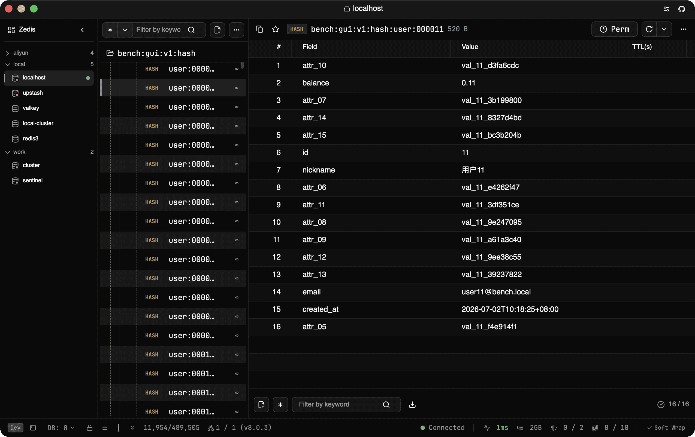
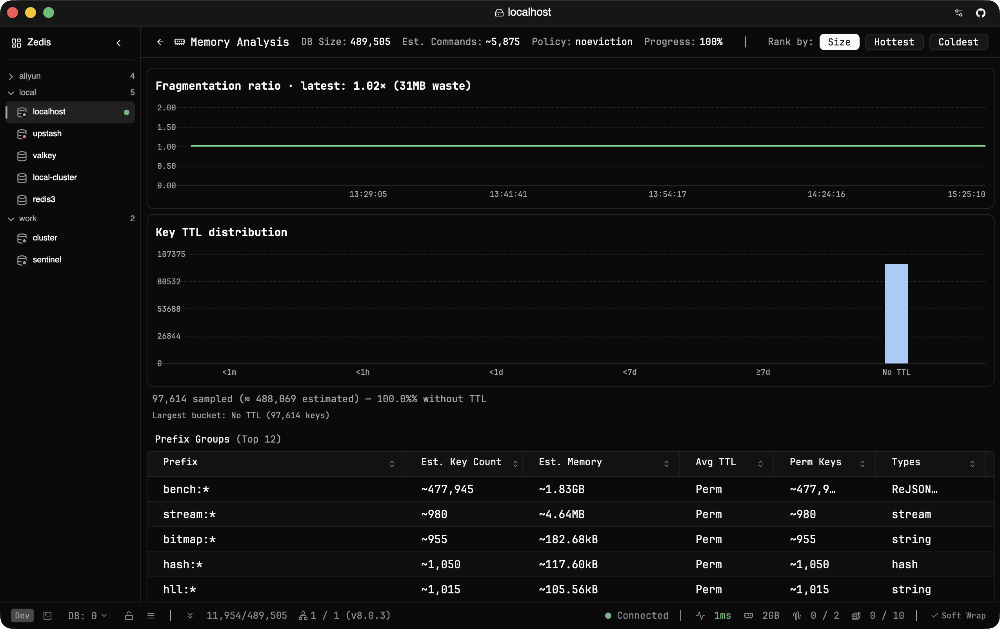
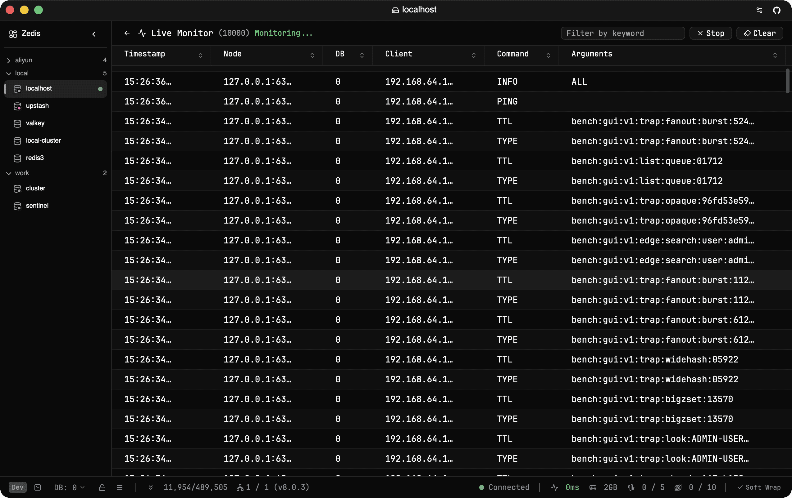
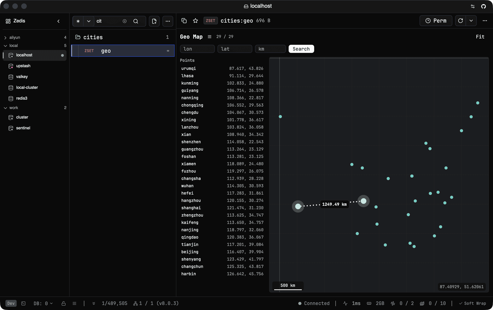
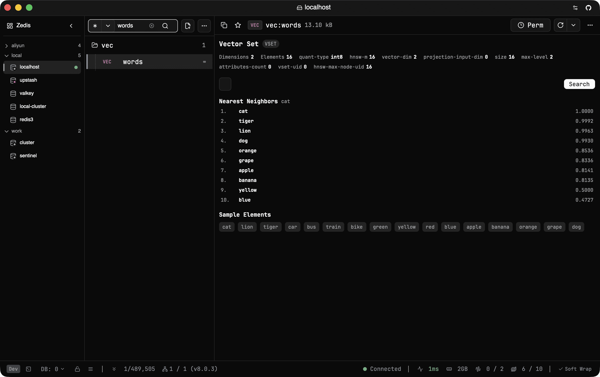
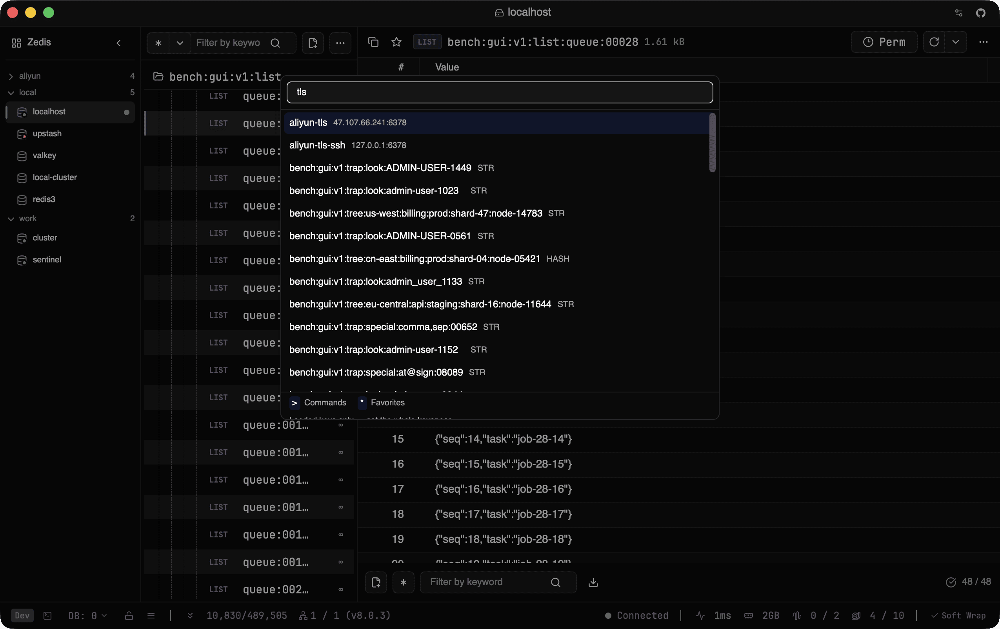

[中文](./README_zh.md) | English

<h1 align="center">Zedis</h1>

<p align="center">
  <strong>The Redis GUI that opens a million-key database without the spinner — native, GPU-accelerated, Rust 🦀 × GPUI ⚡️</strong>
</p>

<p align="center">
  <a href="LICENSE"></a>
  <a href="https://x.com/tree_xie"></a>
  
  <a href="https://www.blazingly.fast"></a>
</p>

<p align="center">
  <a href="#-features">Features</a> ·
  <a href="#-installation">Install</a> ·
  <a href="#-web-version-self-hosted">Web version</a> ·
  <a href="./docs/FEATURES.md">Full feature tour</a> ·
  <a href="https://zedis.net">Website</a>
</p>

<p align="center">
  <video src="https://github.com/user-attachments/assets/d7007ecf-bbfd-4e68-bbaf-437091f711e7" autoplay loop muted playsinline width="100%"></video>
</p>

---

## ✨ Features

**Zedis** is a native Redis and Valkey GUI. [GPUI](https://zed.dev) — the engine behind the Zed editor — draws every frame on the GPU, and `SCAN` is virtual-scrolled, so a million keys stay at 60+ FPS on a small memory footprint.

- 🧠 **Reads your values** — decompresses and decodes on its own: JSON, Protobuf, MessagePack, JWT, images and more, with a viewer for every Redis type and module.
- 📊 **Observability in the same window** — live metrics, a memory analyzer, hot keys, slow log, `MONITOR` and cluster health.
- 🔐 **Safe on production** — Prod connections start write-locked, a destructive command there asks for the server's name, secrets are encrypted per machine, and there is no telemetry.
- 🌐 **Connects to what you actually run** — TLS, SSH, Cluster, Sentinel; Redis and Valkey as first-class; Dragonfly, Garnet, proxies and managed clouds grey out what they lack, with the reason.
- ⌨️ **For people who live in Redis** — ⌘K, a redis-cli with completion, an AI command assistant, copy and diff across servers, and the same app in the browser.

Already on Redis Insight, ARDM or Tiny RDM? **Paste the export and every connection lands at once.**

📖 **[Every panel, viewer and shortcut →](./docs/FEATURES.md)**

## 📦 Installation

### macOS

```bash
brew install --cask zedis
```

### Windows

```bash
scoop bucket add extras
scoop install zedis
```

### Linux

Arch Linux (AUR):

```bash
yay -S zedis-bin
```

Other distributions: `.deb`, `.rpm`, an AppImage and a plain tarball (x86_64 and aarch64) are attached to every [release](https://github.com/vicanso/zedis/releases/latest).

### GPUI Fast build (trial)

Every [release](https://github.com/vicanso/zedis/releases/latest) also carries the same app drawn by GPUI Fast, gpui-kit's optional rendering engine, for x86_64 and aarch64:

| Platform | File |
| --- | --- |
| macOS | `Zedis-<arch>-fast.dmg` |
| Windows | `zedis-windows-<arch>-fast.msi`, or the portable `zedis-windows-<arch>-fast.zip` |
| Linux | `zedis-<arch>-fast.AppImage.tar.gz`, or the plain `zedis-linux-<arch>-fast.tar.gz` |

It is offered so the engine can be tried in real use before anything is decided about it; Homebrew, Scoop, winget, the AUR and the `.deb` / `.rpm` packages install the standard one. In our measurements on macOS it uses less CPU in most cases — about 20% less while scrolling pages such as Config and Metrics, a few percent less in the tables and the editor, the same in the key tree — for about 20% more memory.

On macOS and Windows it installs over the standard app; on Linux it is a file of its own. Either way it keeps your settings, and it updates itself to the Fast build of each new release. *About → Copy System Info* says which one is running (`Renderer: GPUI Fast`) — please include it when you report a problem. To go back, install the standard file from the same page.

<details>
<summary><strong>Build from source with Cargo</strong></summary>

`cargo install` from crates.io gives you the released version. For the newest code before it is released, build from GitHub with `--git`.

```bash
# The released version, from crates.io
cargo install --locked zedis-gui

# The newest code, built straight from GitHub
cargo install --git https://github.com/vicanso/zedis --locked zedis-gui
```

</details>

## 📸 Screenshots

<table>
  <tr>
    <td><a href="docs/images/key-browser.png"></a></td>
    <td><a href="docs/images/memory-analyzer.png"></a></td>
    <td><a href="docs/images/live-metrics.png"></a></td>
  </tr>
  <tr>
    <td align="center"><sub>Key browser & data viewer</sub></td>
    <td align="center"><sub>Memory analyzer</sub></td>
    <td align="center"><sub>Live metrics</sub></td>
  </tr>
  <tr>
    <td><a href="docs/images/geo-map.png"></a></td>
    <td><a href="docs/images/vector-set.png"></a></td>
    <td><a href="docs/images/command-palette.png"></a></td>
  </tr>
  <tr>
    <td align="center"><sub>Geo map</sub></td>
    <td align="center"><sub>Vector Set + KNN</sub></td>
    <td align="center"><sub>Command palette (⌘K)</sub></td>
  </tr>
</table>

## 🌐 Web version (self-hosted)

The same GUI, compiled to WebAssembly. Host it next to Redis; the team opens a tab. `zedis-bridge` serves the page and talks to Redis — passwords stay on the bridge, encrypted at rest, and never reach the browser.

<p align="center">
  
</p>

```bash
docker run -d --name zedis-web -p 7379:7379 \
  -v zedis-data:/data \
  vicanso/zedis-web:latest --listen 0.0.0.0:7379 --insecure-cookie
docker logs zedis-web 2>&1 | grep "setup token"
```

Open <http://localhost:7379> and create the administrator with the setup token from the log. That command is a plain-http trial: drop `--insecure-cookie` and put HTTPS in front.

- **Accounts, roles, SSO** — the first account is the administrator, everyone else registers by invitation or by a request an administrator approves; an entry is private until it is shared; an account can be read-only or limited to some servers; identity can come from a reverse-proxy header.
- **Production stays locked** — Prod entries open for 15 minutes at a time; the audit log records logins, entry changes and every confirmed command.
- **MCP** — Claude Code, Cursor or any MCP client reads Redis as a read-only account, every call audited.
- **Several bridges, one database** — PostgreSQL or MySQL keeps the accounts, logins and audit for bridges behind a load balancer ([guide](./docs/SQL_STORE.md)).

> **Early preview.** linux/amd64 and linux/arm64 (~26 MB). A few desktop panels are missing in the browser; the guide lists them.

📖 **[Self-hosting: HTTPS, accounts, SSO, audit log, MCP →](./docs/WEB.md)**

## 🔀 Redis and Valkey

Valkey is first-class, not a compatibility mode. Whether a version-dependent feature is available is decided by Redis's and Valkey's own version numbers, separately, so a server is never sent a command it did not ship. What only Valkey has — `COMMANDLOG`, atomic slot migration, multiple databases in cluster — has a panel. Copy works both ways even though the two cannot read each other's `DUMP` payloads. CI runs Redis 6.2–8 and Valkey 8.0–9.1 on every change. Dragonfly and Garnet connect too: each is shown under its own name and version, and the commands it does not have are detected and left out (Garnet, for one, has no streams). CI also runs a short connection test against both; neither is held to the full test matrix.

📖 **[Compatibility matrix →](./docs/REDIS_VALKEY.md)**

## 📚 Documentation

- **[Full feature tour](./docs/FEATURES.md)** — every panel, viewer and shortcut.
- **[Web version: self-hosting guide](./docs/WEB.md)** — deployment, accounts, SSO, the audit log and MCP.
- **[Web version: PostgreSQL and MySQL storage](./docs/SQL_STORE.md)** — Docker commands, the database user, TLS, backups, upgrades and the schema.
- **[Redis and Valkey](./docs/REDIS_VALKEY.md)** — what differs between the two, and how a copy between them works.
- **[Security policy](./SECURITY.md)** · **[Changelog](./CHANGELOG.md)**

---

## 🔏 Code signing policy

macOS builds are signed and notarized with the maintainer's Apple Developer ID.

**Team**

- Committers and reviewers: [@vicanso](https://github.com/vicanso)
- Approvers: [@vicanso](https://github.com/vicanso)

Changes from outside the team arrive as pull requests and are reviewed by a committer before they are merged.

**Privacy policy**

This program will not transfer any information to other networked systems unless specifically requested by the user or the person installing or operating it, with two exceptions, both under your control:

- **Update check.** On startup, at most once every two days, Zedis downloads the release manifest from GitHub Releases to learn whether a newer version exists. **If GitHub cannot be reached**, the same request is retried against the [Gitee mirror](https://gitee.com/vicanso/zedis), which the release workflow copies every tagged release to — so the check, and any download you start, still work on networks where GitHub does not. Either way the request carries nothing but the app version in its `User-Agent` — nothing about you, your machine or your data — and a download is verified against the SHA-256 in the release manifest, so a mirror serving anything else fails the same check a corrupted transfer would. Turn it off with *Settings → Check for Updates Automatically*; a new version is only downloaded when you click Update.
- **AI assistant.** Only after you enter an endpoint under *Settings → AI Base URL*, the text you explicitly hand it — a command description, a memory report — is sent to that endpoint and nowhere else.

Your Redis servers, SSH tunnels and the optional proxy connect only where you point them. Zedis has no telemetry and sends no crash reports: they stay on disk until you export a diagnostics bundle yourself.

---

## 🤝 Contributing

Issues and PRs are welcome — features, translations, bug fixes. Opening a PR means you agree to the [Contributor License Agreement (CLA)](./CLA.md).

## 📄 License

Zedis is open-source software licensed under the [Apache License, Version 2.0](./LICENSE).
