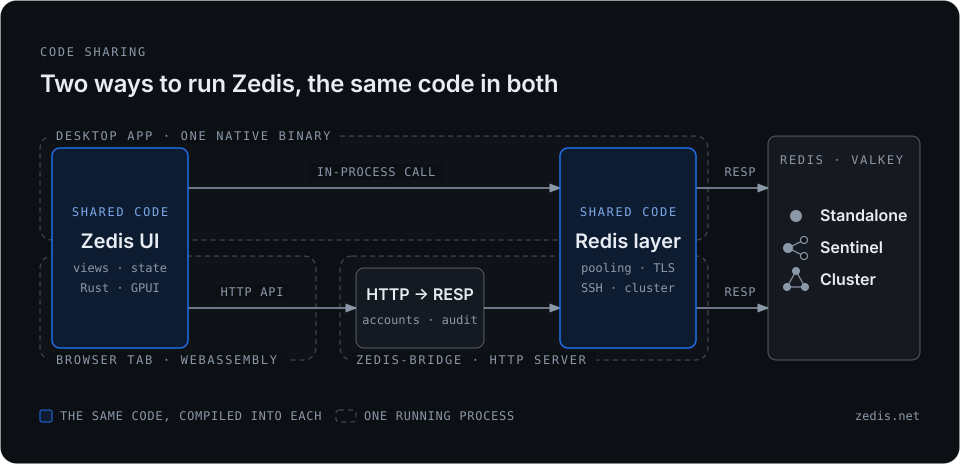

中文 | [English](./WEB.md) · [← 返回 README](../README_zh.md)

# Zedis Web 版：自托管指南

Zedis 也能在浏览器里运行：同一套代码编译成 WebAssembly，用 canvas 渲染。浏览器无法直接建立 TCP 连接，所以由一个很小的 HTTP 服务 —— `zedis-bridge` —— 同时提供页面，并代替浏览器与 Redis 通信。在 Redis 旁边部署一次，整个团队打开浏览器就能用，无需安装任何东西。Redis 的密码只保存在 bridge 上（加密存储），不会发送给浏览器。

<p align="center">
  
</p>

> **早期预览。** 镜像已发布 linux/amd64 与 linux/arm64 两个架构（约 26 MB）：正式发布对应 `:latest` 与版本号标签，`:nightly` 是跟随 `main` 的滚动构建。

## 快速试用

```bash
docker run -d --name zedis-web -p 7379:7379 \
  -v zedis-data:/data \
  vicanso/zedis-web:latest --listen 0.0.0.0:7379 --insecure-cookie
docker logs zedis-web 2>&1 | grep "setup token"
```

打开 <http://localhost:7379>。bridge 还没有管理员时，页面显示**创建管理员**：填入日志里的初始化令牌（setup token）、一个用户名和一个密码（至少 8 个字符），就以这个管理员身份登录了。其他人从标题栏菜单的**账号…**邀请（见[账号与共享](#账号与共享)）。

- **账号是注册出来的，不是配置出来的。** 第一个账号就是管理员，用一次性的初始化令牌创建：bridge 把它打印在日志里，并写入 `/data/setup-token`（仅属主可读，用过即删）；也可以用 `-e ZEDIS_BRIDGE_SETUP_TOKEN=…` 事先指定，方便安装脚本使用。其他人都通过邀请链接注册 —— 设置了 `--signup approval` 的话，也可以在登录页申请账号，等管理员审核。脚本用某个账号的 HTTP Basic 登录（`curl -u admin:… …/v1/servers`）。
- **`/data`** 保存服务器列表（其中的密码由同目录的 `master.key` 加密）、账号（密码以 Argon2id 哈希保存）和已保存的登录状态。请保留这个卷，否则每次重启都是空的，连管理员也没有。
- **`--insecure-cookie` 仅用于纯 http 的试用。** 登录 cookie 默认带 `Secure`，而浏览器会静默丢弃通过纯 http 收到的 `Secure` cookie —— 只有 `localhost` 例外（部分浏览器连 `localhost` 也不例外）。不加这个参数时，现象是登录成功、紧接着的请求返回 `401`。
- **Redis 跑在 Docker 宿主机上**时，容器内的 `127.0.0.1` 指的是容器自己。请使用 `host.docker.internal`（Linux 上需加 `--add-host=host.docker.internal:host-gateway`）或 `--network host`。

## 正式部署

纯 http 下，账号密码以及从 Redis 读到的所有数据都是明文传输。除试用外，请去掉 `--insecure-cookie`，端口只发布到回环地址，并在前面放一个 HTTPS 反向代理：

```bash
docker run -d --name zedis-web -p 127.0.0.1:7379:7379 \
  -v zedis-data:/data \
  vicanso/zedis-web:latest
```

```caddyfile
zedis.example.com {
    reverse_proxy 127.0.0.1:7379
}
```

把地址告诉别人之前，先创建好管理员：在那之前，谁拿到初始化令牌，谁就成为管理员。同一地址在一刻钟内失败 10 次后，bridge 会拒绝它的后续尝试（`429`）—— 按账号名分别计数，初始化令牌和邀请码也一样。经反向代理时所有请求都来自代理的地址，这时的计数就变成了所有人按账号名共用一份；如果 bridge 能从内网之外访问，仍请在代理层加上限流。

bridge 自己会压缩发出的内容：页面的文件在构建镜像时压缩一次（brotli 和 gzip），API 的应答在发送时压缩——浏览器支持 zstd 时用 zstd（Chrome 123、Firefox 126、macOS 26.3 上的 Safari 26.3），否则用 gzip，1 KB 以上才压缩。前面的反向代理不需要再开压缩；Caddy 的 `encode` 和 nginx 的 `gzip` 遇到已经编码过的应答会原样转发。

## 与其它应用共用域名

如果域名不是 Zedis 独占的，可以用 `ZEDIS_BRIDGE_BASE_PATH`（或 `--base-path`）给 bridge 指定一个专属路径。页面、静态资源和 API 会全部移到这个前缀之下，前缀之外的路径一律不响应；登录 cookie 的作用范围也限定在这个前缀内 —— 同域名下的其它应用不会收到它。

```bash
docker run -d --name zedis-web -p 127.0.0.1:7379:7379 \
  -e ZEDIS_BRIDGE_BASE_PATH=/zedis \
  -v zedis-data:/data \
  vicanso/zedis-web:latest
```

```caddyfile
tools.example.com {
    # 用 `handle` 而不是 `handle_path`：前缀要原样转发，不能剥掉。
    handle /zedis* {
        reverse_proxy 127.0.0.1:7379
    }
    # … 其它应用
}
```

访问 `https://tools.example.com/zedis/`。nginx 的等价写法是 `location /zedis { proxy_pass http://127.0.0.1:7379; }` —— `proxy_pass` 末尾不要加斜杠，否则前缀会被剥掉。健康检查地址也随之变为 `/zedis/v1/health`。

## 多个 bridge 共用一个数据库

默认情况下 bridge 把所有东西都存在数据目录里：只有一个进程，不需要额外的服务，备份就是复制一个目录。要运行多个 bridge（放在负载均衡后面，或者让某个 bridge 宕机时不会把所有人都踢下线），或者想要一个能检索的审计记录，就让所有 bridge 共用同一个 PostgreSQL 14+ 或 MySQL 8.0.19+ 数据库：

```bash
docker run -d --name zedis-web -p 127.0.0.1:7379:7379 \
  -v zedis-data:/data \
  -e ZEDIS_BRIDGE_STORE='postgres://zedis:…@db.internal:5432/zedis?sslmode=require' \
  vicanso/zedis-web:latest
```

这个功能从 v0.14.0 之后的第一个正式版本开始提供，在那之前请用 `vicanso/zedis-web:nightly`。[PostgreSQL 与 MySQL 存储指南](./SQL_STORE_zh.md)里有两种数据库的 Docker 启动命令、数据库用户与权限、TLS、备份、升级和建表语句；下面是简要说明。

`ZEDIS_BRIDGE_STORE`（或 `--store`）是一个 `postgres://…` 或 `mysql://…` URL。推荐用环境变量：URL 里带着密码，而命令行参数能被任何可以列出进程的人看到。日志里只会出现它的主机部分。bridge 启动时会建表，每次升级时把表结构更新到当前版本，期间持有数据库自己的锁，所以同时启动的多个 bridge 只会执行一次；比表结构旧的 bridge 会拒绝启动。不支持 MariaDB。

这时存进数据库的有：账号、邀请、账号申请和 MCP 令牌，登录状态，服务器列表，回收站，指标历史，页面数据，初始化令牌，以及登录失败记录。在一个 bridge 上登录，在所有 bridge 上都算已登录；登录失败 10 次是所有 bridge 合计 10 次；在一个 bridge 上做的变更 —— 停用账号、删掉一条服务器规则、退出登录 —— **两秒内**传到其他 bridge。审计也默认开启并存在数据库里（见[审计日志](#审计日志)）。

需要安排好三件事：

- **所有 bridge 用同一个 `master.key`。** 服务器密码和回收站内容在写进数据库之前都用它加密。第一个打开空数据库的 bridge 会用自己的 key 封存一个校验值，key 不同的 bridge 会拒绝启动，而不是写入其他 bridge 解不开的密码。把同一个文件挂载进每个 bridge（`/data/master.key`），并且和数据库分开备份：只有其中一个毫无用处，两者也不该放在一起。
- **让每个浏览器固定落在同一个 bridge 上**，按 `zedis_bridge` 登录 cookie 做会话粘滞。登录本身不需要这一点，需要它的是那些不是数据的东西：终端会话，以及 Pub/Sub、Monitor、键空间通知面板，都是某个 bridge 里开着的 Redis 连接，它们的请求落到别的 bridge 会被拒绝；已解锁的写入窗口在那里也要重新解锁。一个 bridge 宕机，页面丢掉的是这些，而不是登录状态。在线客户端（`GET /v1/clients`）和 MCP 调用限额按 bridge 分别统计。
- **健康检查。** 负载均衡的健康检查请指向 `/v1/ready`：这个 bridge 的数据库两秒内没有响应时它返回 `503`，流量就会转到其他 bridge，数据库恢复后再返回 `200`。`/v1/health` 只表示进程还活着 —— 适合做容器的存活探针，因为数据库不可用时重启 bridge 也无济于事。
- **时钟同步**（NTP），和任何多主机服务一样：登录过期、回收站清理、指标采样都按各个 bridge 自己的时钟。

MySQL 8 默认使用 `caching_sha2_password` 认证；请开启 TLS（`?ssl-mode=REQUIRED`）—— 不开时 bridge 会用 RSA 加密发送密码，但之后的所有内容都是明文传输。`zedis-bridge setup-token` 读取同一个 `ZEDIS_BRIDGE_STORE`，把新的令牌存进数据库。

**迁移已有的 bridge。** 先停掉它，然后把它的数据目录一次性复制进空数据库 —— 账号、邀请和待处理的申请、登录状态（不用重新登录）、服务器列表、脚本、页面数据，回收站和指标历史保持原样，等待中的初始化令牌，加上 `--audit-file` 的话还有审计文件：

```bash
docker run --rm -v zedis-data:/data \
  -e ZEDIS_BRIDGE_STORE='postgres://…' \
  vicanso/zedis-web:latest import-local --audit-file /data/audit.log
```

它使用那个目录的 `master.key`，此后这个数据库上的每个 bridge 都要用它；如果数据库里已经有账号、服务器条目或脚本，会拒绝导入。迁移之后要回退，只能靠数据库自己的备份。

## 账号与共享

服务器条目属于添加它的账号，其他人看不到；勾选**共享**（Shared）后则对所有账号可见。能看到共享条目、且有写权限的账号都可以编辑或删除它。

账号由 bridge 保存（`/data` 下的 `bridge-accounts.json`，仅属主可读），在它的页面上创建，从不写进配置。每个账号是三种角色之一：

- **管理员** —— 完整权限账号能做的都能做，另外还管理账号页上的账号、邀请与账号申请。
- **完整权限** —— 在它看得到的条目上可读可写。
- **只读** —— 只能读（见下文）。

第一个账号是管理员，用初始化令牌创建（见[快速试用](#快速试用)）。之后的每个账号都来自一份**邀请**：管理员在账号页（标题栏菜单的**账号…**）选好角色、它能看到哪些共享服务器、链接有效几天（默认 7 天，最长 90 天），然后把生成的链接发出去。一个链接只能注册一个账号，用户名和密码由对方自己定，用完即失效；bridge 只保存邀请码的哈希，未使用的邀请可以在同一页上撤销。邀请码放在链接的 `#` 之后，浏览器不会把这一段放进请求，所以也不会出现在沿途代理的访问日志里。

**账号申请**是第二个入口，默认关闭，需要自己打开：`--signup approval`（`-e ZEDIS_BRIDGE_SIGNUP=approval`）。之后登录页会出现**申请账号**：填一个名字、一个密码，可以给管理员留一句说明。申请不能登录，也看不到任何东西：它在账号页的**账号申请**一栏里等着，管理员选好角色和能看到的共享服务器（不改的话就是只读、全部共享条目）后点**通过**，就用申请人设的密码创建账号；也可以**拒绝**。不管名字是否已被占用，申请人得到的回答都一样，所以这个表单不会透露哪些账号存在；申请的名字已有账号使用时，会标为*名字已被占用*，只能拒绝。申请和登录失败一样按地址计入一刻钟十次的限制，同时最多等待 100 个，七天无人处理就会被删除。每一步都记一行审计（`signup_requested`、`signup_approved`、`signup_rejected`），`--audit-webhook` 默认会推送 `signup_requested` —— 管理员就是这样得知有人在等。登录代理断言的名字不会变成申请：配置了 `--trusted-header` 时，这类账号仍然通过勾选了代理的邀请注册。

**演示账号**：很多人共用同一个账号登录时，在它的表单上勾选**锁定**（管理员账号不提供这个选项）。锁定后，它不能修改自己的密码和 MCP 令牌 —— 管理员仍然可以 —— bridge 也不为它保存收藏、最近打开的 key、搜索历史和偏好设置，所以一个访问者改的语言或收藏不会变成下一个人看到的：偏好设置留在各自的浏览器里，其余的只在页面打开期间有效。同时把它设为只读，并用服务器规则只开放演示用的条目。

在同一页的账号表里，管理员还可以修改账号的角色和服务器规则、停用或删除账号，或者给忘了密码的人生成一个**重置链接…**——它只能设置一次新密码。每个人都在账号页上修改自己的密码。最后一个管理员不能被降级、停用或删除。万一所有管理员都丢了，在宿主机上执行 `zedis-bridge setup-token`（`docker exec zedis-web /usr/local/bin/zedis-bridge setup-token`）：它会打印一个新的初始化令牌，页面重新提供*创建管理员*，可以新建账号，也可以用已有账号自己的密码把它设为管理员。这件事通过 HTTP 做不到 —— 能登录宿主机，就等于掌握了 bridge。

删除账号会结束它的登录和令牌，且无法撤销；改为勾选**已停用**则只是不让它登录，可以恢复。账号自己私有的东西 —— 私有的服务器条目和保存的脚本 —— 不会留在 bridge 上无人可见：确认框会把它们列出来，问清怎么处理。可以转交给另一个账号（默认是执行删除的管理员，也可以另选；只读或已停用的账号不行）、共享给所有账号，或者一并删除 —— 条目的回收站、指标历史和 key 备注也一起删除。共享从来不会是默认选项，因为私有条目里带着主人的 Redis 密码。每一项都记一行审计（`server_updated` 记录 owner 从谁改为谁、`server_deleted`、`script_saved`、`script_deleted`），`account_deleted` 则写明它们去了哪里。脚本通过 `DELETE /v1/admin/accounts/{name}` 删除时，在请求体里说明同样的选择 —— `{"private":{"action":"hand_to","account":"alice"}}`、`{"private":{"action":"share"}}` 或 `{"private":{"action":"delete"}}`；不带请求体时，它们归脚本登录所用的账号。在有这个功能之前删除的账号，可能已经留下了这样的东西；账号一节会在*已删除账号遗留的内容*下列出它们，每项都有**处理…**，三种选择相同（`orphans_settled`）。

服务器规则限定账号能看到哪些**共享**条目，一行一条——按名字匹配（`*`、`?` 是通配符）或用 `id:` 加条目 id 精确指定——规则末尾加 `:ro` 表示在这些条目上只读，其它条目上仍是账号原本的权限。多条规则对同一条目意见不一时，**可写优先**：宽的规则做限制，例外单独点名，`prod-*:ro` 加 `prod-eu` 就是 `prod-*` 的条目都只读、其中 `prod-eu` 可写。没有规则时，看到全部共享条目。账号自己添加的条目永远可见可写。条目名是所有者自己起的，能编辑条目的人改个名字，就能让它匹配上或不再匹配某条规则——在意这一点就用 `id:`。

**只读账号**可以查看它能看到的一切，但什么都改不了：不能写 Redis，也不能新增、编辑或删除服务器条目。拦截是 bridge 做的，不是页面 —— 任何不是读的请求都会收到 `403`，所以脚本直接请求 `/v1/exec` 和页面一样会被拒绝，带上确认参数也不会放行。判定用的是**读命令的白名单**，而不是"要避开的写命令"清单：`EVAL` 能执行任意脚本，`BITFIELD` 名字像读、实际会写，`GETDEL` 与 `GETEX` 名字是 get、实际是写，而模块命令根本不在 Redis 核心的命令表里 —— 因此不认识的一律拒绝；白名单万一漏了某个读命令，表现就是对应的面板提示不可用。

修改账号的密码、角色或服务器规则，或者停用它，都会让它已有的登录失效，所以把某个账号降为只读，对已经登录的浏览器同样立即生效。标题栏菜单的最后一项**退出登录**会立即结束当前这次登录 —— 是在 bridge 上作废，而不只是清掉这个浏览器的 cookie。不主动退出的话，登录在 30 天未使用后失效；登录时取消勾选 *Keep me signed in on this device* 则是 8 小时。重启 bridge 不会让任何人退出登录。

这是纵深防御，不能替代 Redis 自己的 ACL：Redis ACL 用户带上 `-@write` 后，限制由服务端在每条连接上执行，谁来连都一样；而这里的限制由 bridge 执行，浏览器能连到的也只有 bridge。两者一起用 —— ACL 是保证，账号角色是让按钮在请求发出之前就变灰的那一层。

### 从配置账号升级

有注册之前，账号是配置出来的：`ZEDIS_BRIDGE_USERS`（`alice@secret,bob:ro@hunter2`）或一份 `[[users]]` 表格式的 TOML 文件（`--users-file`、`ZEDIS_BRIDGE_USERS_FILE`）。仍然设置了其中之一的 bridge，在升级后第一次启动时会把这些账号导入一次（仅当账号存储为空时）：密码转为哈希，只读角色、`servers` 规则和 MCP token 一并带过来 —— 大家原来怎么登录，现在还怎么登录。它们都不会成为管理员，因为原来的配置从没做过这个决定，所以 bridge 同时会打印一个初始化令牌：打开页面，选*创建管理员*，填入令牌和某个已有账号自己的用户名与密码，这个账号就成为管理员。每导入一个账号，审计日志记一行 `account_imported`。此后这项设置会被忽略 —— 每次启动都会有一条警告提醒 —— 可以删掉了。

## 接入你自己的 SSO

公司里已经有单点登录的话，通行做法是在应用前面放一个认证反向代理——oauth2-proxy、Authelia、Pomerium、Cloudflare Access、Tailscale 都是这一类：代理负责登录，把登录者是谁写进一个请求头。可以让 bridge 信任这个请求头：

```bash
-e ZEDIS_BRIDGE_TRUSTED_HEADER=Remote-User          # --trusted-header
-e ZEDIS_BRIDGE_TRUSTED_PROXY=10.0.0.0/8,172.17.0.5  # --trusted-proxy：代理的地址
```

两个要么都配，要么都不配：任何人都能在请求里自己写一个 `Remote-User: alice`，所以只有**来自代理**的连接上这个头才算数——判断依据是 socket 对端地址，永远不看 `X-Forwarded-For`。头里的名字必须是 bridge 上的账号；不是账号的名字会被 `403` 拒绝（并记入审计日志），而不是当成新用户放进来。角色仍由 bridge 决定，因为代理只回答"你是谁"，不回答"你能做什么"。

这样的账号用勾选了**通过代理登录**的邀请来注册（配置了上面两项时才提供这个选项）。经代理打开邀请链接，注册的就是代理写进头里的那个名字 —— 原样照搬，代理发的是 `alice@example.com` 就是 `alice@example.com` —— 角色取自邀请，没有密码，所以这个账号无法绕过代理登录。用初始化令牌创建的管理员有密码；角色选管理员并勾选代理的邀请，可以再建一个经代理登录的管理员。

代理必须做到两件事：转发的每个请求都剥掉或覆盖这个头；并且是访问 bridge 的唯一入口——如果 bridge 还能被直连，地址检查就形同虚设。各家代理只有头名不同：Authelia 是 `Remote-User`，oauth2-proxy 是 `X-Auth-Request-User`（需开 `--set-xauthrequest`），Cloudflare Access 是 `Cf-Access-Authenticated-User-Email`，Tailscale 是 `Tailscale-User-Login`。不配这两项时，这个头根本不会被读取。

## 生产环境的写入锁

打了 **Prod** 标签的条目，桌面和浏览器里写入都默认锁定（任何条目都可以在“安全”标签页的“写入”里选：跟随标签 / 允许 / 锁定 / 只读）。点状态栏的锁并输入服务器名，写入会解锁 **15 分钟**——按钮上显示剩余时间，到点自动重新锁上。浏览器里这 15 分钟由 bridge 按账号分别计时（`POST` / `DELETE /v1/servers/{id}/unlock`，审计记为 `unlocked` / `locked`），解锁时段之外的写入和破坏性命令一样收到 `428`，脚本和页面一视同仁。从浏览器发往这类条目的 Lua 脚本或函数调用（`EVAL` / `EVALSHA` / `FCALL`，`_RO` 形式除外）每次都要确认，解锁期间也一样，Prod 上还要输入服务器名——因为从命令本身看不出脚本会写什么。升级后，已有的 Prod 条目也会默认锁定；不想要就把它的“写入”改为“允许”。

## 审计日志

`--audit-log /data/audit.log`（`ZEDIS_BRIDGE_AUDIT_LOG`）会为每个事件追加一行 JSON：每次登录、登录失败与退出登录，只读账号被拒绝的每次请求，账号的每一次变动 —— 用初始化令牌创建管理员、邀请的创建与撤销、账号申请的提交、通过与拒绝、账号的注册、修改（角色、服务器规则、是否停用、是否锁定，改前改后）、删除（以及它私有的东西去了哪里）与导入、已删除账号遗留内容的处理、密码的修改与重置、MCP token 的签发与吊销，从不记密码、邀请码或 token 本身 —— Lua 脚本的保存与删除，服务器条目的新增、编辑（改了哪些设置、改前改后的值；改了哪些密码之类的敏感字段，只记字段名不记值；私有条目被改为共享）和删除、每条管理服务器的命令 —— `CONFIG SET`、`ACL SETUSER`、`REPLICAOF`、`MODULE LOAD`、`CLIENT KILL`、`FLUSHDB` 之类 —— 每条需要人确认才放行的命令（所以开了“写入确认”的条目，在终端里输入的每一次写都会留痕），以及每个从回收站移出的 key（恢复或丢弃；恢复时的 `RESTORE` 另有一行写命令记录）。`--audit-writes`（`ZEDIS_BRIDGE_AUDIT_WRITES=1`）再加上普通的数据写命令，以及随之放进回收站的每个被删除的 key；读命令永远不记。参数里的密码会被抹掉，过长的值会截断，同一批里的同名命令合并成一行并记数量，文件创建时的权限是仅属主可访问。

```json
{"ts":"2026-09-25T08:12:03.417Z","account":"alice","peer":"10.0.0.7:51234","event":"command","server":{"id":"0199…","name":"prod"},"db":0,"command":"CONFIG","args":["SET","maxmemory","2gb"],"outcome":"confirmed","kind":"config_set","confirm":"type_name"}
```

这只是 bridge 这一扇门的日志：`redis-cli` 和应用程序直连 Redis 的操作不在里面；它回答不了"谁改了这个 key"，能回答的是"有没有人手动改过"。bridge 只追加、从不重新打开文件，轮转请用 `copytruncate`。

使用[数据库](#多个-bridge-共用一个数据库)时，审计**默认开启**并存在数据库里 —— 所有 bridge 的记录在同一张表 —— 保留 365 天（`--audit-retention-days`、`ZEDIS_BRIDGE_AUDIT_RETENTION_DAYS`；`0` 表示永久保留）。`--audit-log /路径` 改为写文件（每个 bridge 各写一份），`--audit-log off` 关闭审计，`--audit-writes` 照旧追加普通数据写入。写不进去的记录会作为错误写进 bridge 自己的日志，相关的请求照常放行。

**查看审计。** 管理员在账号页（**账号…** → *审计*）查看：最新的在前，可按账号和事件筛选，分页加载，选中一行显示完整内容。脚本可以调用 `GET /v1/admin/audit`，参数可选 `account`、`event`、`server`（服务器条目的 id）、`since_ms` / `until_ms`（unix 毫秒）和 `limit`，用上一页返回的 `next` 作为 `before` 继续翻页。写文件时，每一页最多从上一页停下的位置往前读 16 MB，并会注明（`"stopped_early": true`）；存在数据库里时是全量查询。

### 推送到群聊

`--audit-webhook <url>`（`ZEDIS_BRIDGE_AUDIT_WEBHOOK`）把需要人留意的审计行实时推送到群聊，开不开 `--audit-log` 都可以。填机器人的 webhook 地址，消息格式按域名自动识别——飞书 / Lark（`open.feishu.cn`、`open.larksuite.com`）、钉钉（`oapi.dingtalk.com`）、企业微信（`qyapi.weixin.qq.com`）、Slack（`hooks.slack.com`）；其它地址收到的是审计行本身的 JSON，`{"source":"zedis-bridge","events":[…]}`，方便接自己的程序。经过中转、从域名看不出来时，用 `--audit-webhook-format json|feishu|dingtalk|wecom|slack`（`ZEDIS_BRIDGE_AUDIT_WEBHOOK_FORMAT`）指定。飞书或钉钉机器人开了签名校验的，把密钥放进 `ZEDIS_BRIDGE_AUDIT_WEBHOOK_SECRET`（也有 `--audit-webhook-secret` 参数，但命令行参数在进程列表里本机所有用户都看得到）。

```bash
docker run -d --name zedis-web -p 127.0.0.1:7379:7379 \
  -e ZEDIS_BRIDGE_AUDIT_LOG=/data/audit.log \
  -e ZEDIS_BRIDGE_AUDIT_WEBHOOK="https://open.feishu.cn/open-apis/bot/v2/hook/…" \
  -e ZEDIS_BRIDGE_AUDIT_WEBHOOK_SECRET="…" \
  -v zedis-data:/data \
  vicanso/zedis-web:latest
```

群里每条审计行是一句话：

```text
[zedis-bridge audit, times in UTC]
08:12:03 alice ran, confirmed, CONFIG SET maxmemory 2gb on prod db0 from 10.0.0.7
08:13:00 mallory failed to sign in from 203.0.113.9
```

推送的是审计日志所记内容的一个子集。默认推送除登录、退出登录和 MCP 工具调用之外的所有事件——这三种整天都在发生；`--audit-webhook-events`（`ZEDIS_BRIDGE_AUDIT_WEBHOOK_EVENTS`）可以改成一个列表——`login`、`login_failed`、`no_account`、`logout`、`refused`、`command`、`server_added`、`server_updated`、`server_deleted`、`unlocked`、`locked`、`trash_put`、`trash_removed`、`setup_completed`、`invite_created`、`invite_revoked`、`account_registered`、`account_updated`、`account_deleted`、`orphans_settled`、`password_changed`、`token_issued`、`token_revoked`、`account_imported`、`script_saved`、`script_deleted`、`tool`——或 `all`。命令里只推送管理服务器的命令，以及需要人确认或被拒绝的命令：普通的数据写永远不推，开了 `--audit-writes` 也一样，否则忙一个上午群就被刷屏了；被删除的 key 放进回收站也不推，道理相同。

推送从不拖慢请求：审计行先进队列，第一行到达 3 秒后发出，一条消息最多 20 行，这样也不会超过机器人的频率限制（企业微信每分钟 20 条）。发送失败会在 5 秒后重试一次，仍失败就在进程日志里记一条警告；机器人返回错误码（签名不对、机器人已停用）也算失败。URL 里带着机器人的密钥，所以进程日志只记它的域名——启动时的 `audit webhook on` 一行列出域名、格式、推送的事件以及是否签名。URL、格式或事件名写错时，bridge 在启动时就会报错退出；给不签名的机器人（企业微信、Slack、JSON）配了密钥也一样，免得你以为消息是签过名的。

## 在线客户端

bridge 会统计谁在使用它。一个客户端从第一次请求起算在线，连续 5 分钟没有请求就算下线：每次浏览器登录算一个（同一浏览器的多个标签页共用登录 cookie，只算一个），用 HTTP Basic 认证的脚本按"账号 + 地址"各算一个，MCP token 按名字各算一个，经可信代理登录的按账号各算一个。打开了连接的页面每 10 秒发一次心跳（后台标签页 60 秒），只要开着就一直在线；停在首页、没打开任何连接的页面不发请求，5 分钟后算下线。退出登录会立即下线。

进程日志会在客户端上线和下线时各记一行，并带上当前在线数：

```text
INFO zedis_bridge::api: client online account="alice" kind="browser" online=3
INFO zedis_bridge: client offline account="ops" kind="basic" online=2
```

`GET /v1/clients` 返回当前在线的客户端，最近有请求的排在前面，并列出每个客户端在同样这 5 分钟内用过的服务器——页面打开的、终端的、订阅的、工具调用的——最近用的在前。结果里有其他账号的名字、来源地址和在用的服务器，所以和账号列表一样只有管理员能看，其他账号会被拒绝（`403`；开了审计日志时会记一行）；服务器只列出提问者自己能看到的，别人的私有条目不会因为有人在用而被暴露出来：

```console
$ curl -s -u alice:secret https://zedis.example.com/v1/clients
{"process":"4c1f…","online":2,"window_secs":300,"clients":[
  {"account":"alice","kind":"browser","peer":"10.0.0.7","last_seen":"2026-10-17T04:21:57.000Z","seen_at":1792210917,"idle_secs":4,
   "servers":[{"id":"3f2a…","name":"prod"}]},
  {"account":"ai","kind":"token","token":"claude-laptop","peer":"10.0.0.9","last_seen":"2026-10-17T04:20:41.000Z","seen_at":1792210841,"idle_secs":80,
   "servers":[]}]}
```

页面里同样的列表在 **账号… → 在线**，只有管理员能看到：谁、从哪里、在用哪些服务器、最后活动时间——管理员要重启或清空一台共享服务器之前，可以先看看还有谁在用它。

`peer` 是 TCP 连接的对端，经反向代理时是代理的地址；代理写了 `X-Forwarded-For` 时会多一个 `forwarded_for`。在线数只保存在内存里：bridge 重启后，每个客户端在下一次请求时重新计入。[多个 bridge](#多个-bridge-共用一个数据库) 时各自统计自己的客户端，`process` 表明是哪个 bridge 回答的。

## 让 AI 助手只读访问（MCP）

`POST /v1/mcp` 是一个 [Model Context Protocol](https://modelcontextprotocol.io) 服务端，Claude Code、Cursor 或任何 MCP 客户端都可以经由 bridge 读取你的 Redis —— 只能读。助手登录的账号**必须是只读的** —— 用这个账号的 token（见下文），或像脚本一样用 HTTP Basic；完整权限的账号在这里无论请求什么都会被拒绝。工具是按模型而不是按终端的习惯设计的：`list_servers`、`scan_keys`（分页，集群的每个 master 都会扫到）、`inspect_key`（类型、TTL、内存、编码、长度和一小段预览）、`server_info` 与 `slowlog`（按 master 解析好）；四个做汇总而不是罗列的工具——`slowlog_summary`（慢日志按命令汇总，最重的在前，并列出最慢的几条）、`hotkeys`（读取已在运行的 `HOTKEYS` 采集报告，Redis 8.6+；启动采集会改变服务器状态，所以留给人来做）、`memory_summary`（最多抽 5000 个 key，用 `MEMORY USAGE` 测量后按前缀汇总，并列出最大的 key）和 `troubleshooting_report`（一次性拉取概览、各节点 `INFO`、`MEMORY DOCTOR`、`LATENCY DOCTOR`、`LATENCY LATEST`、脱敏慢日志与关键配置的结构化排查快照）；以及兜底的 `read_command`，跑任意其它只读命令。工具发出的每条命令都要过页面用的那份只读白名单，此外还会拒绝会改动共享连接状态的命令（`SELECT`、`AUTH`、`CLIENT SETNAME`、`SUBSCRIBE` 等）；写入、`_RO` 形式以外的脚本、管理命令以及会返回凭据的读（读密码的 `CONFIG GET`、`ACL LIST`）都会被拒绝，并附上模型读得懂的原因。大值会截断到能放进模型上下文的大小，每个账号每分钟最多 120 次调用，而且**每次调用都是审计日志里的一行** —— 读也记，因为调用者是替人做事的程序。

给助手一个 **token**，而不是账号的密码。为它邀请一个只读账号，以这个账号登录后打开**账号…**：在 *MCP 令牌*下，用机器或客户端给 token 起个名字（`claude-laptop`），需要的话填上到期日，然后签发。管理员也可以在账号表里给任意只读账号签发（*签发令牌…*），这样签发的 token 默认 90 天后到期，可以另选日期，或清空日期表示永不过期。已经过去的日期不能选。token 只显示一次；bridge 只保存它的 SHA-256。

客户端把它放在请求头里：

```sh
claude mcp add --transport http zedis https://bridge.example.com/v1/mcp \
  --header "Authorization: Bearer ${ZEDIS_MCP_TOKEN}"
```

token 只能在 `/v1/mcp` 登录，别处都不行 —— 页面不行，API 也不行 —— 所以 MCP 客户端明文存在配置文件里的，不是一个能打开页面的密码。要停掉某一台机器，在同一页上吊销它的 token 即可，下一次调用就会被拒绝；到期日从那一天的第一秒（UTC）起拒绝它；每次调用的审计日志都会写明是哪个 token（`"auth":"token","token":"claude-laptop"`）。token 只属于只读账号：完整权限的账号签发不了，持有 token 的只读账号在 token 全部吊销之前也不能改成别的角色。为了兼容在有 token 之前配置的客户端，`/v1/mcp` 仍然接受 HTTP Basic：

```sh
claude mcp add --transport http zedis https://bridge.example.com/v1/mcp \
  --header "Authorization: Basic $(printf 'ai:secret' | base64)"
```

助手和页面走的是同一个入口，而不是另开一条通道：账号的服务器规则决定助手看得见哪些条目，审计日志记录它读了什么，数据不经过任何第三方。

## 流式面板

实时监控（MONITOR）、Pub/Sub、键空间通知需要一条由服务器主动推送的连接，网页拿不住这种连接。bridge 替页面拿着它（`/v1/watch`），页面用一个最长等待 20 秒的请求去取到达的内容——所以 bridge 前面的反向代理要允许请求空闲超过 20 秒（nginx 默认的 60 秒没问题）。每个打开的面板会占着一个这样的请求；纯 HTTP/1.1 下浏览器对同一主机最多 6 个并发连接，这也是建议用 HTTPS（HTTP/2）部署 bridge 的又一个理由。

- **Pub/Sub 和键空间通知**只是旁观：只读账号也能用，在它能看到的任何条目上都可以。
- **MONITOR** 能看到所有客户端的命令（包括值），运行期间还会拖慢服务器。只限完整账号；在写入锁定的条目上（Prod 默认锁定）会先问写锁的确认问题——Prod 上要输入服务器名——但不会因此打开写入窗口；每次开启都记一行审计日志（也会推送到审计 Webhook）；bridge 会在 10 分钟后自动停止它。
- 关闭面板或关掉标签页都会释放连接：页面来得及通知时立刻释放，否则一两分钟内由 bridge 回收。
- 键空间通知面板的“启用”按钮会发 `CONFIG SET`，bridge 对它每次都要确认，所以页面会先问你。

## 回收站与指标历史

这两项都由 bridge 保存在它的数据目录里（镜像中是 `/data`），因为网页刷新后什么都留不住：

- `bridge-trash/`——回收站：被删除的 key 的值保留 24 小时（值不超过 1 MB；每台服务器最多 1000 个 key / 128 MB，超出时淘汰最旧的），和服务器密码一样用 bridge 的 `master.key` 加密保存。回收站属于服务器：能看到这个条目的人都能看到从中删了什么、是谁删的，恢复需要对它有写权限。可在每个浏览器的“设置 → 键行为”里关闭。
- `bridge-metrics/`——每台服务器每分钟一个指标样本，保留一周，由当时打开着这台服务器的页面上报。和桌面版一样，历史只覆盖有人打开着它的时段；bridge 自己从不去轮询服务器。

删除服务器条目时两者一并删除。这些文件和 bridge 的其他文件一样，只有属主可访问。

## 保存在 bridge 上的数据

桌面版存在本地数据库里的东西，bridge 替页面保存：在应用启动前载入，有改动就随时保存 —— 存在下面列出的文件里，bridge 配了[数据库](#多个-bridge-共用一个数据库)时则存在数据库里。

- **每个账号自己的**——收藏、最近打开的 key、搜索历史、设置和 proto 查看规则（`bridge-page-data/accounts/`）。它们跟着账号走，换哪个浏览器都一样，别人看不到；只读账号也有自己的一份。删除账号时一并删除。
- **key 的标签和备注**（`bridge-page-data/key-notes/`）——属于服务器：能看到这台服务器的人都能看到，每条都记着是谁、在什么时候留下的。按 key 逐条保存，所以两个人给两个 key 打标签不会互相覆盖。在这台服务器上不能写的账号——只读账号，或规则在这里写了 `:ro` 的账号——只能看，不能加。删除服务器条目时一并删除。
- **保存的 Lua 脚本**（`bridge-scripts.json`）——默认归保存它的人；在脚本库里勾选*共享*后对所有账号可见。和共享的服务器条目一样，有写权限的账号都能修改或删除共享脚本；只读账号可以运行脚本，但改不了。每次保存、删除都记一行审计（`script_saved`、`script_deleted`），因为共享脚本会被别人运行，也包括在生产环境上。脚本的运行次数只留在当前页面。

不保存在 bridge 上的：终端的命令历史——里面是输入过的原文，包括写入的值，而且命令本身已经记在审计日志里。页面把它存在当前浏览器里（`localStorage`，按账号分开，每台服务器保留最近 100 条），凭据会被抹掉——`AUTH`、`CONFIG SET requirepass` 之类按 ↑ 调出来是 `***`——所以刷新页面还在，换个浏览器就没有了。其他账号的改动 —— 标签、备注、保存的脚本，以及本账号在别的浏览器里改的自己的列表 —— 一分钟内就会出现在打开着的页面上；打开一台服务器或脚本库、或者回到这个标签页时会立刻去取。没人看着的标签页不会去问，内容没变时 bridge 只回一个 `304`。它不会盖掉本页正在发往 bridge 的改动，也不会改写正打开着的脚本表单 —— 表单里输入的内容保持不变，以最后一次保存为准。

## Web 版不包含的功能

所有“一问一答”式的功能都可用——键树、各类型的值编辑器、终端、指标（含 1 小时 / 24 小时 / 7 天历史）、慢日志、配置、客户端、内存分析、按值搜索、多数据库键搜索（⌘⇧F）、跨服务器对比（这里是对话框，含“复制到目标”）、服务器间 key 复制、排查报告、proto 查看规则（菜单里的 *Protobuf*：粘贴定义或选择 `.proto` 文件，在页面里编译，可以导入 `google/protobuf` 标准类型，没有包含目录）、回收站、Lua 脚本库——流式面板也可用：实时监控（MONITOR）、Pub/Sub、键空间通知（见下文“流式面板”）。所有导出都以下载方式保存——各面板的 CSV 和 JSON、值、终端输出、连接导出、排查报告，以及连同值一起导出 key（工具菜单里的*导出 Key…*，或在键树里对一个 key、一个文件夹或多选的 key 操作：JSON 或 CSV，与桌面版可读导出写出的文件相同，在标签页里生成，所以最多 64 MB，也可以直接复制到其他服务器）；导入值、导入 key（工具菜单里的*导入 Key…*：最大 64 MB 的 JSON 或 CSV 导出文件，支持冲突预览及跳过/覆盖/中止）、把连接导出文件载入导入框、离线分析 RDB 备份（最大 256 MB，会整个读进标签页）时，通过浏览器选择文件。从页面写入的值最多约 1.5 MB，这是 bridge 单个请求的上限（2 MB 的 JSON，值以 base64 放在里面）：更大的字符串或 JSON 值在网页版里以只读方式打开并说明原因，从文件导入值也以同样大小为上限。*诊断连接*（连接的右键菜单，或连不上服务器时显示的面板）由 bridge 执行——从 bridge 所在的位置依次检查 DNS、TCP、SSH、TLS、AUTH 和 PING，因为在网页版里替页面连接服务器的正是 bridge（`POST /v1/servers/{id}/diagnose`）；它诊断的是已保存的连接，所以这里的连接表单没有“诊断”按钮。浏览器中不可用的有：拓扑与 Sentinel 管理、脚本查看器（它们要运行程序）、二进制 `.zedis-dump` 导出与导入，以及被浏览器自己占用的快捷键（⌘N / ⌘T / ⌘W / ⌘Q）。凡是需要路径或第二个窗口的也不可用：关于窗口，以及安装版自己的维护功能：更新、日志目录、诊断包。设置以对话框的形式打开，只包含适用于网页的部分——外观、日期时间、键行为、工作区标签——不包含安装版程序相关的部分（连接超时在浏览器里由 bridge 决定；AI 助手；托盘、更新器与代理；备份文件）。在那里的设置保存在当前浏览器中。值编辑器在网页版里也会像桌面版一样给 JSON 和 Lua 着色，只是换成了更轻量的高亮器（syntect——桌面版用的 tree-sitter 无法编译成 WebAssembly）：代码块按花括号折叠；超过 512 kB 的值不着色，因为网页每次停顿输入后都要在唯一的线程上把整个值重新解析一遍。标签、备注、收藏、最近打开的 key、搜索历史、保存的脚本、proto 查看规则和设置都由 bridge 保存（见*保存在 bridge 上的数据*）；终端的命令历史保存在浏览器里。放在后台标签页里的页面会自行降低轮询频率。不提供的功能就不出现：浏览器里没有对应的菜单项、按钮和快捷键，而不是点了没反应。桌面应用仍是功能完整的客户端。

不使用 Docker 的话，`make web-dist` 可以把同样的内容构建成一个自包含的单文件二进制。
